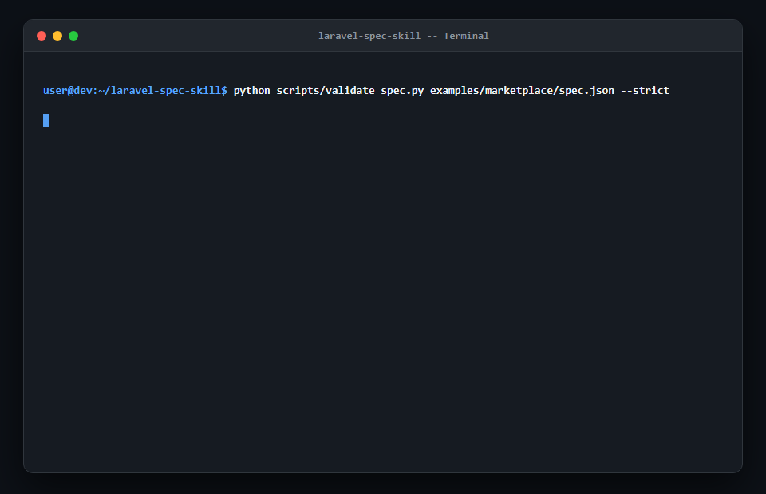

# laravel-spec-skill

[](https://github.com/AryaMehr-Nam/laravel-spec-skill/actions/workflows/ci.yml)
[](https://www.python.org/downloads/)
[](LICENSE)
[](https://github.com/AryaMehr-Nam/laravel-spec-skill/releases/tag/v0.1.0)
[](https://github.com/agentskills/agentskills)

> **Spec-driven development skill for AI agents that turns plain-language requirements into machine-validated specifications and test-driven builds for Laravel 11/12 and Filament v3/v4 applications.**

---

## 10-Second Demo & Walkthrough



> **Illustrative agent session walkthrough** (simulated interaction demonstrating the 5-phase workflow):


```
[Agent] Phase 1 Discovery: Analyzed composer.json (Laravel 12, Filament v3). Asked 5 targeted questions.
[Agent] Phase 2 Spec Generation: Synthesized spec/spec.json with 5 models, 2 roles, 2 panels.
[Agent] Phase 3 Validation: Executing scripts/validate_spec.py...
        ✓ Structural & Uniqueness checks passed
        ✓ Relational integrity (5 models, 8 relationships) verified
        ✓ Authorization matrix complete (super-admin defined, policies bound)
        ✓ State machine acyclicity & terminal states verified
        ✓ Financial precision enforced (integer minor units)
        ✓ Milestone DAG verified (3 milestones, 0 cycles)
        ✓ Security & PII audit logging enforced
        Validation result: 0 ERRORS, 0 WARNINGS. Spec is valid!
[Agent] Phase 4 Review Gate:
        Project: ElectroMarket (Laravel 12 / Filament v3)
        Roles: super-admin, vendor, customer
        Panels: Admin (/admin), Vendor (/vendor)
        Models: User, Product, Order, OrderItem, Payment
        Milestones: M1 Core Catalog -> M2 Orders & Escrow -> M3 Vendor Dashboard
        Ready to proceed to Phase 5 TDD build? [Y/n]
```

### Reproducible CLI Commands

> **Real CLI output** (run these locally on the bundled marketplace example):

You can record the exact terminal demo into `demo.gif` using [VHS](https://github.com/charmbracelet/vhs) (`vhs demo.tape`) or run the commands locally in 10 seconds:

```bash
# 1. Clone and navigate to repo
git clone https://github.com/AryaMehr-Nam/laravel-spec-skill.git
cd laravel-spec-skill

# 2. Inspect and validate one of the production examples (29 rules)
python scripts/validate_spec.py examples/marketplace/spec.json --strict

# 3. Deterministically render the 10 modular docs and Artisan commands
python scripts/render_docs.py examples/marketplace/spec.json --output-dir demo-output/docs
python scripts/render_commands.py examples/marketplace/spec.json --output demo-output/commands.sh

# 4. View the generated dry-run command sequence
head -n 25 demo-output/commands.sh

# 5. (Optional) Record reproducible demo.gif using bundled VHS tape script
vhs demo.tape
```

---

## Quickstart & Installation

Install `laravel-spec-skill` into your agentic workspace in seconds:

### Option A: Via `npx skills` (Standard Agent Skills CLI)

```bash
npx skills add github:AryaMehr-Nam/laravel-spec-skill
```

### Option B: Via Bundled Zero-Dependency Installer

```bash
# Command 1: Clone repo
git clone https://github.com/AryaMehr-Nam/laravel-spec-skill.git

# Command 2: Install into all detected agent workspaces (Antigravity, Claude Code, Cursor, Codex)
python laravel-spec-skill/scripts/install.py --target all
```

*Want project-local installation only?* Run `python laravel-spec-skill/scripts/install.py --target antigravity --project`.

### Option C: Manual Copy (Zero Scripting)

Copy the skill directory directly into your agent's skills folder and add the instruction pointer:

| Agent | Workspace Directory | Global Destination | Instruction Pointer |
| :--- | :--- | :--- | :--- |
| **Antigravity** | `.agents/skills/laravel-spec/` | `~/.gemini/antigravity/skills/` *(or `~/.gemini/config/skills/`)* | `GEMINI.md` |
| **Claude Code** | `.claude/skills/laravel-spec/` | `~/.claude/skills/laravel-spec/` | `CLAUDE.md` |
| **Cursor** | `.cursor/skills/laravel-spec/` *(or `.agents/skills/`)* | `~/.cursor/skills/laravel-spec/` | `AGENTS.md` |
| **OpenAI Codex CLI** | `.agents/skills/laravel-spec/` | `~/.codex/skills/laravel-spec/` *(or `~/.agents/skills/`)* | `AGENTS.md` |

> **Note on `npx skills`**: Verified with `npx skills add github:AryaMehr-Nam/laravel-spec-skill`, which auto-detects Antigravity/Codex and copies the skill directly into `.agents/skills/laravel-spec/`.

Pointer block to paste into your instruction file:
```markdown
<!-- LARAVEL-SPEC-SKILL:START -->
### Laravel Spec Skill
This environment is configured with `laravel-spec` for specification-driven
Laravel and Filament development. When tasked with specifying, architecting,
or building Laravel or Filament applications, activate and follow `laravel-spec`.
<!-- LARAVEL-SPEC-SKILL:END -->
```

---

## Cross-Agent Compatibility Matrix

We enforce a strict **Honesty Rule**: an agent is marked **Verified** only if it has undergone automated end-to-end integration and prompt validation. All other targets are marked **Experimental**.

> **Honesty Rule**: All four target harnesses are classified as **Experimental (v0.1.0)** for this initial release until broader multi-OS community feedback is gathered. Automated tests verify installer directory structure and pointer injection.

| Agent Harness | Status | Tested Scope | Configuration Pointer |
| :--- | :---: | :--- | :--- |
| **Antigravity** | **Experimental (v0.1.0)** | Live session & CLI tested (see `tests/fixtures/agent_runs/antigravity_verification.md`), 158 tests passing | `GEMINI.md` |
| **Claude Code** | **Experimental (v0.1.0)** | Standard SKILL.md format & local installer tests passing | `CLAUDE.md` |
| **Cursor** | **Experimental (v0.1.0)** | Directory layout (`.cursor/skills/` and `.agents/skills/`) & pointer tests passing | `AGENTS.md` |
| **OpenAI Codex CLI** | **Experimental (v0.1.0)** | Standard `.agents/skills/` directory layout & pointer tests passing | `AGENTS.md` |

---

## Why `laravel-spec-skill`?

Standard LLM workflows fail on non-trivial Laravel + Filament codebases because they generate code prematurely:
1. **Float Currency Bugs**: LLMs frequently use `float` columns for money, introducing rounding errors in financial transactions.
2. **Missing Relational Indexes**: Agents create foreign keys without database indexes, degrading query performance.
3. **Broken Authorization**: Resources are generated without Filament query scopes or policies, leading to critical tenant isolation leaks.
4. **Circular Milestones**: Task execution gets stuck in unresolvable dependency loops.

`laravel-spec-skill` solves this by introducing a **machine-validated specification gate** before any application code is generated.

```
                              THE SPECIFICATION GATE
                              
  Plain Requirements               spec/spec.json               Production Code
 ────────────────────► [Phase 1 & 2] ──────────► [Phase 3] ──────────► [Phase 5]
                        Discovery &                29-Rule              Test-Driven
                        Synthesis                 Validator            Milestone Build
                                                     │
                                             Zero Errors Required
```

---

## How It Works: The 5 Phases

`laravel-spec-skill` guides the agent through a structured 5-phase lifecycle:

```
[Phase 1: Discovery]
        │  • Inspect composer.json, models, migrations
        │  • Batched questionnaire (<= 7 targeted questions)
        ▼
[Phase 2: Spec Generation]
        │  • Synthesize canonical spec/spec.json
        │  • Deterministically render 10 modular docs (00-overview.md - 09-open-questions.md)
        │  • Generate dry-run Artisan commands (spec/commands.sh)
        ▼
[Phase 3: Machine Validation] ◄──┐
        │  • Zero-dependency validator (scripts/validate_spec.py)
        │  • 29 architectural invariant checks
        ├── If violations found ─┘ (Fix spec.json and re-run)
        ▼
[Phase 4: Review Gate]
        │  • Emit concise <= 15-line architectural executive summary
        │  • Await explicit user sign-off
        ▼ (Approved)
[Phase 5: Resumable TDD Build]
        │  • Execute milestones defined in DAG order
        │  • Red-Green-Refactor: Pest/PHPUnit tests before business logic
        │  • Pint formatting & Larastan level 8 type analysis
        • Update spec/PROGRESS.md checkpoint after each milestone
```

---

## Validation Rules Overview (29 Invariant Rules)

The bundled Python validator (`scripts/validate_spec.py`) requires zero third-party dependencies (Python 3.10+ standard library only) and enforces 29 rigorous rules across 7 categories:

| Category | Rules | Description |
| :--- | :--- | :--- |
| **Structural & Uniqueness** | `STRUC_001`, `UNIQ_001`, `UNIQ_002` | Validates root schema structure, entity identifier uniqueness, and database table uniqueness. |
| **Relational Integrity** | `REL_001`, `REL_002`, `REL_003`, `REL_004` | Confirms target relation models exist, verifies inverse relationship declarations, flags missing foreign key indexes (`REL_003`), and validates foreign key target models. |
| **Authorization & Policies** | `AUTH_001` - `AUTH_006` | Verifies declared roles in policies, ensures every Filament resource has a bound policy (`AUTH_002`), requires standard CRUD abilities, mandates super-admin role (`AUTH_004`), and flags unreferenced roles (`AUTH_005`). |
| **State Machines** | `SM_001` - `SM_006` | Enforces state field declaration, initial state definition, reachability analysis, dead-end state detection (`SM_004`), transition authorization checks, and disallows transitions from terminal states. |
| **Financial & Data Types** | `NUM_001`, `ENUM_001` | **Strictly prohibits `float` on currency fields** (enforces integer minor units or decimal scale >= 2), and validates non-empty `enum_values` on enum fields. |
| **Milestone DAG** | `DAG_001` - `DAG_004` | Enforces acyclic milestone graphs using Kahn's topological sort algorithm, validates dependency existence, warns on unmapped models (`DAG_003`), and requires >= 2 acceptance criteria per milestone. |
| **Security & PII** | `SEC_001` - `SEC_004` | Mandates `project.audit_log: true` when any field is flagged with `pii: true` (`SEC_001`), enforces upload constraints (`max_size_kb`, `allowed_mimes`), validates policy `ownership_field`, and verifies tenant `query_scope` on Filament resources (`SEC_004`). |

Detailed documentation with trigger conditions, examples, and fix hints is available in [`skills/laravel-spec/references/validation-rules.md`](skills/laravel-spec/references/validation-rules.md).

---

## Curated Presets Guide

`laravel-spec-skill` includes 4 pre-engineered architectural presets designed for localized and multi-tenant requirements:

### 1. `rtl-fa` (Persian RTL & Localized Stack)
- **What it does**: Configures Filament panels for Right-to-Left (RTL) typography, binds Jalali solar dates (`morilog/jalali`), and bundles the Vazirmatn font locally with **zero external CDN dependencies**.
- **When to use**: Any application targeting Persian/Farsi-speaking users or Iran domestic intranet environments.
- **Reference**: [`skills/laravel-spec/references/presets/rtl-fa.md`](skills/laravel-spec/references/presets/rtl-fa.md)

### 2. `iran-payments` (Shetab / Shaparak Payment Gateways)
- **What it does**: Implements multi-gateway routing (Zarinpal, Shepa, Saman SEP), atomic database callback verification, unique `idempotency_key` constraints to eliminate double-crediting, and explicit Rial vs. Toman currency normalization.
- **When to use**: E-commerce, subscription billing, or wallet systems operating in Iran.
- **Reference**: [`skills/laravel-spec/references/presets/iran-payments.md`](skills/laravel-spec/references/presets/iran-payments.md)

### 3. `otp-login` (Passwordless SMS Authentication)
- **What it does**: Implements secure mobile OTP authentication, multi-tiered IP/phone rate limiting (e.g. max 3 requests per 10 minutes), 120-second code expiration, single-use cryptographic verification nonces, and user enumeration defense.
- **When to use**: Mobile-first applications where users authenticate via phone number instead of passwords.
- **Reference**: [`skills/laravel-spec/references/presets/otp-login.md`](skills/laravel-spec/references/presets/otp-login.md)

### 4. `multi-tenant` (SaaS Multi-Tenancy)
- **What it does**: Provides dual-mode architectural patterns: Single-Database row-level tenant scoping (via `tenant_id`, Filament panel tenancy, and global Eloquent query scopes) and Multi-Database complete database isolation using `stancl/tenancy`.
- **When to use**: Multi-tenant B2B SaaS platforms and white-label portals.
- **Reference**: [`skills/laravel-spec/references/presets/multi-tenant.md`](skills/laravel-spec/references/presets/multi-tenant.md)

---

## Test Suite & Verification

Every rule, script, template, and preset is comprehensively tested across Python 3.10, 3.11, 3.12, and 3.13:
- **158 passing unit & integration tests** in under 6 seconds.
- **28 deliberate error fixtures** ensuring every validation rule triggers with precise JSON paths and fix hints.
- **Deterministic SHA-256 validation** guaranteeing byte-for-byte doc rendering across runs.
- **Ruff linter and formatter**: 0 errors, 100% compliant.

Run tests locally:
```bash
python -m pytest -v
python -m ruff check .
```

---

## Reference Examples Included

Inspect complete reference specification packages in the repository:

- **[`examples/marketplace/`](examples/marketplace/)**: Multi-vendor marketplace with vendor escrow, order fulfillment state machine, Filament Admin & Vendor panels, and payment processing.
- **[`examples/crm/`](examples/crm/)**: Customer Relationship Management (CRM) with sales leads state machine, activity logging, customer ownership scoping, and audit trails.

Each example includes:
- `spec.json`: Complete specification matching the formal JSON schema.
- `docs/`: 10 deterministically rendered markdown documents (`00-overview.md` to `09-open-questions.md`).
- `commands.sh`: Dependency-ordered dry-run Artisan scaffolding script.
- `validation.txt`: Machine validation report proving 0 errors.

---

## Honest Limitations & Roadmap

We believe in honest open-source documentation:

### Current Limitations
- **Python Host Requirement**: The validation and rendering toolchain requires Python 3.10+ installed on the host machine. (The generated application code is 100% PHP / Laravel).
- **Filament-Centric Admin UI**: The skill excels at Laravel + Filament architectures. It does not generate standalone Inertia.js (Vue/React) or Livewire Volt SPAs unless integrated with a Filament panel.
- **Dry-Run Scaffolding**: `commands.sh` produces standard Laravel Artisan scaffolding commands (`make:model -mfsc`, `make:policy`, `make:filament-resource`). It does not write the internal PHP method bodies; Phase 5 TDD guides the LLM to write tests and implementations iteratively.
- **Relational Databases Only**: Validation rules assume relational SQL engines (MySQL, PostgreSQL, SQLite). MongoDB / NoSQL schemas are not supported by the relational foreign key rules.

### Roadmap
- [ ] **Livewire 3 / Volt Preset**: Standalone consumer frontend preset without Filament dependencies.
- [ ] **Inertia.js + React/Vue Preset**: Single-page application frontend specification and TypeScript DTO generation.
- [ ] **Interactive Schema Viewer**: Zero-dependency browser viewer for exploring `spec.json` visually.
- [ ] **Direct Larastan AST Verification**: Automatic static analysis checks during Phase 5 milestone validation.

---

## Contributing a Preset

We welcome community presets! To propose a new preset (e.g. `stripe-subscriptions`, `oauth-social`, `audit-compliance`):

1. Read our [`CONTRIBUTING.md`](CONTRIBUTING.md) guide.
2. Create a markdown architecture guide in `skills/laravel-spec/references/presets/<preset-name>.md`.
3. Provide model schema fragments, package requirements, security patterns, and testing recommendations.
4. Open a pull request using our preset template.

---

## License

This project is open-source software licensed under the [MIT License](LICENSE).
